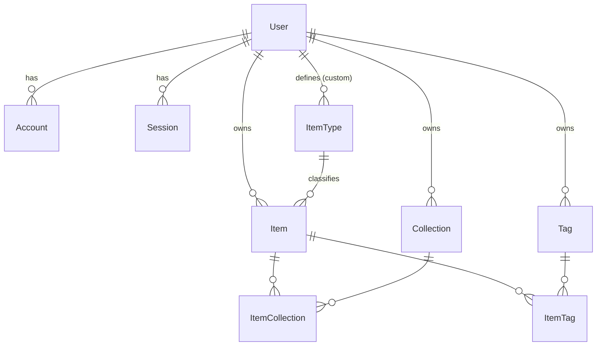
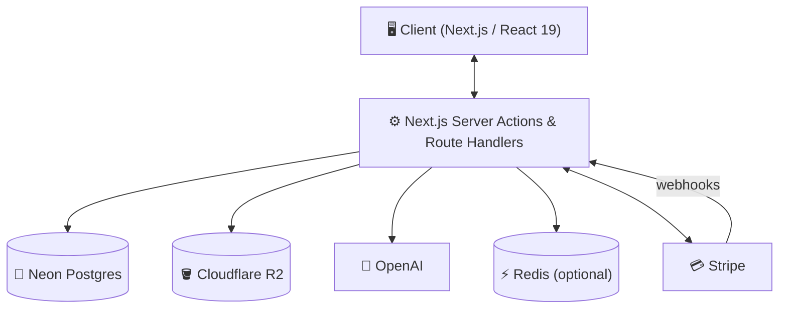
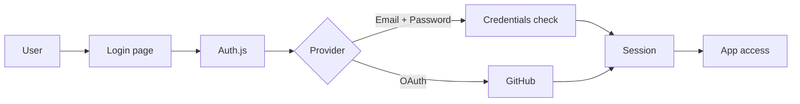
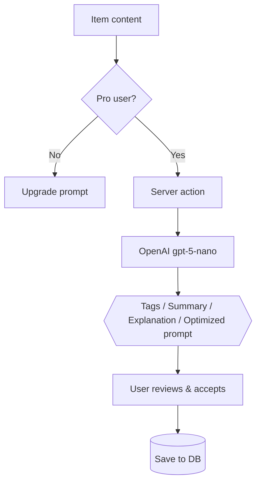
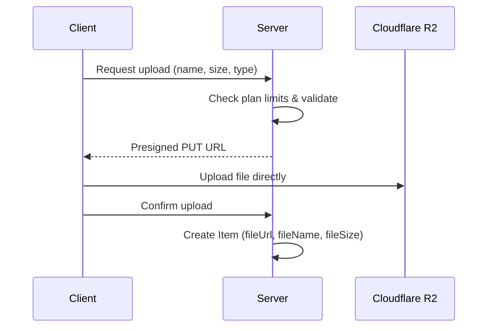
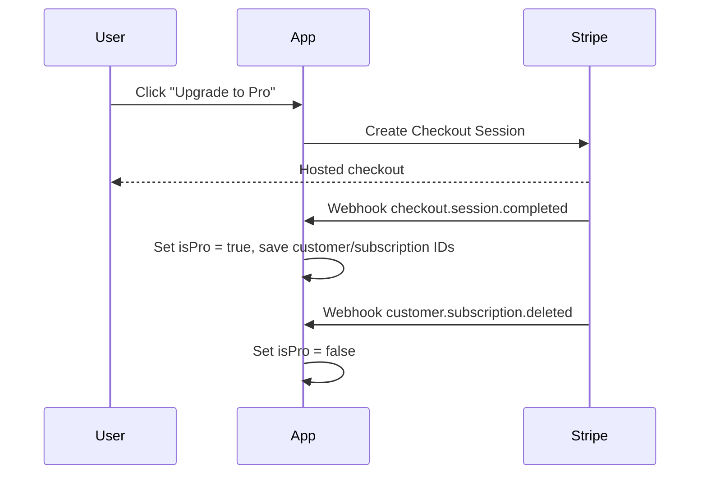

# 🗃️ DevStash — Project Overview

> **Store Smarter. Build Faster.**
> A centralized, AI-enhanced knowledge hub for developers: code snippets, AI prompts, notes, commands, files, images and links in one searchable place.

|                  |                                                                                                            |
| ---------------- | ---------------------------------------------------------------------------------------------------------- |
| **Status**       | 📝 Planning → ready for environment setup & UI scaffolding                                                 |
| **Type**         | SaaS (freemium, Stripe subscriptions)                                                                      |
| **Stack**        | Next.js · TypeScript · Neon Postgres · Prisma · Tailwind v4 · shadcn/ui · Auth.js · Cloudflare R2 · OpenAI |
| **Last updated** | 26 Oct 2026                                                                                                |

---

## Table of Contents

1. [Problem](#-problem)
2. [Target Users](#-target-users)
3. [Core Features](#-core-features)
4. [Item Types](#-item-types)
5. [Data Model (Prisma)](#️-data-model-prisma)
6. [Tech Stack](#-tech-stack)
7. [Architecture](#-architecture)
8. [Monetization](#-monetization)
9. [UI / UX](#-ui--ux)
10. [Development Workflow](#️-development-workflow)
11. [Roadmap](#-roadmap)
12. [Open Questions & Decisions](#-open-questions--decisions)
13. [Reference Links](#-reference-links)

---

## 📌 Problem

Developers keep their essentials scattered across many tools:

| What              | Where it usually lives          |
| ----------------- | ------------------------------- |
| Code snippets     | VS Code, Notion                 |
| AI prompts        | Buried in chat histories        |
| Context files     | Deep inside individual projects |
| Useful links      | Browser bookmarks               |
| Docs              | Random folders                  |
| Commands          | `.txt` files, bash history      |
| Project templates | GitHub Gists                    |

**Result:** constant context switching, lost knowledge and inconsistent workflows.

➡️ **DevStash provides ONE searchable, AI-enhanced hub for all developer knowledge and resources.**

---

## 🧑‍💻 Target Users

| Persona                           | Primary needs                                         |
| --------------------------------- | ----------------------------------------------------- |
| 👨‍💻 **Everyday Developer**         | Fast access to snippets, commands and links           |
| 🤖 **AI-First Developer**         | Store and refine prompts, workflows and context files |
| 🎓 **Content Creator / Educator** | Save course notes and reusable code                   |
| 🏗️ **Full-Stack Builder**         | Patterns, boilerplates, API references                |

---

## ✨ Core Features

### A) Items

The core unit of DevStash. Every item has a **type** (system or custom), optional tags, and can live in one or more collections.

### B) Collections

Group related items — **mixed item types allowed**.

> Examples: `React Patterns` · `Context Files` · `Python Snippets` · `Interview Prep`

### C) Search

Full-text search across **title, content, description, tags and type**, with filters for type, collection, favourites and pinned.

### D) Authentication

- 📧 Email + password (credentials)
- 🐙 GitHub OAuth

### E) Productivity

- ⭐ Favourites and 📌 pinned items/collections
- 🕒 Recently used items
- 📥 Import from files
- ✍️ Markdown editor for text-based items
- 📎 File uploads (images, docs, templates)
- 📤 Export (JSON / ZIP)
- 🌙 Dark mode by default

### F) 🧠 AI Superpowers (Pro)

| Feature                | What it does                                   |
| ---------------------- | ---------------------------------------------- |
| 🏷️ Auto-tagging        | Suggests tags from item content                |
| 📝 AI summaries        | One-line / short summaries of long items       |
| 🔍 Explain Code        | Plain-English walkthrough of a snippet         |
| ⚡ Prompt optimization | Rewrites prompts for clarity and effectiveness |

> Powered by **OpenAI `gpt-5-nano`** (cheap, fast — suits short, high-volume tasks).

---

## 🧩 Item Types

System types are seeded at install time (`isSystem = true`, `userId = null`). Pro users can create **custom types**.

| Type    | Icon ([Lucide](https://lucide.dev/icons)) | Color        | Content kind | Notes                                 |
| ------- | ----------------------------------------- | ------------ | ------------ | ------------------------------------- |
| Snippet | `Code`                                    | `#3b82f6` 🔵 | text         | Syntax highlighting, `language` field |
| Prompt  | `Sparkles`                                | `#8b5cf6` 🟣 | text         | Prompt optimization target            |
| Note    | `StickyNote`                              | `#fde047` 🟡 | text         | Markdown                              |
| Command | `Terminal`                                | `#f97316` 🟠 | text         | One-click copy                        |
| File    | `File`                                    | `#6b7280` ⚪ | file         | Stored in R2 — **Pro**                |
| Image   | `Image`                                   | `#ec4899` 🩷 | file         | Stored in R2 — Free & Pro             |
| URL     | `Link`                                    | `#10b981` 🟢 | url          | Optional metadata/preview             |

---

## 🗄️ Data Model (Prisma)

> ⚠️ Starting point — **this schema will evolve.**

Changes from the original draft:

- ✅ Added the **Auth.js** models (`Account`, `Session`, `VerificationToken`) required by the Prisma adapter.
- ✅ `contentType` is now an **enum** (`TEXT | FILE | URL`) instead of a free string.
- ✅ Items ↔ Collections is **many-to-many** (an item can live in several collections).
- ✅ Added `isPinned` to collections and `lastUsedAt` to items (for _Recently used_).
- ✅ Added `onDelete: Cascade`, uniqueness constraints and indexes for common queries.

```prisma
generator client {
  provider = "prisma-client-js"
}

datasource db {
  provider  = "postgresql"
  url       = env("DATABASE_URL")       // Neon pooled connection
  directUrl = env("DIRECT_URL")         // Neon direct connection (migrations)
}

// ─────────────────────────────────────────────
// Enums
// ─────────────────────────────────────────────

enum ContentType {
  TEXT
  FILE
  URL
}

// ─────────────────────────────────────────────
// Users & Auth (Auth.js / NextAuth v5)
// ─────────────────────────────────────────────

model User {
  id                   String    @id @default(cuid())
  name                 String?
  email                String    @unique
  emailVerified        DateTime?
  image                String?
  password             String?   // hashed (bcrypt/argon2); null for OAuth-only users

  // Billing
  isPro                Boolean   @default(false)
  stripeCustomerId     String?   @unique
  stripeSubscriptionId String?   @unique

  accounts    Account[]
  sessions    Session[]
  items       Item[]
  itemTypes   ItemType[]
  collections Collection[]
  tags        Tag[]

  createdAt DateTime @default(now())
  updatedAt DateTime @updatedAt
}

model Account {
  id                String  @id @default(cuid())
  userId            String
  type              String
  provider          String
  providerAccountId String
  refresh_token     String? @db.Text
  access_token      String? @db.Text
  expires_at        Int?
  token_type        String?
  scope             String?
  id_token          String? @db.Text
  session_state     String?

  user User @relation(fields: [userId], references: [id], onDelete: Cascade)

  @@unique([provider, providerAccountId])
}

model Session {
  id           String   @id @default(cuid())
  sessionToken String   @unique
  userId       String
  expires      DateTime

  user User @relation(fields: [userId], references: [id], onDelete: Cascade)
}

model VerificationToken {
  identifier String
  token      String   @unique
  expires    DateTime

  @@unique([identifier, token])
}

// ─────────────────────────────────────────────
// Core domain
// ─────────────────────────────────────────────

model Item {
  id          String      @id @default(cuid())
  title       String
  description String?
  contentType ContentType @default(TEXT)

  // TEXT
  content     String?     @db.Text
  language    String?     // e.g. "typescript", "bash" — for syntax highlighting

  // FILE (Cloudflare R2)
  fileUrl     String?
  fileName    String?
  fileSize    Int?        // bytes
  mimeType    String?

  // URL
  url         String?

  isFavorite  Boolean     @default(false)
  isPinned    Boolean     @default(false)
  lastUsedAt  DateTime?

  userId String
  user   User     @relation(fields: [userId], references: [id], onDelete: Cascade)

  typeId String
  type   ItemType @relation(fields: [typeId], references: [id])

  tags        ItemTag[]
  collections ItemCollection[]

  createdAt DateTime @default(now())
  updatedAt DateTime @updatedAt

  @@index([userId, typeId])
  @@index([userId, isPinned])
  @@index([userId, lastUsedAt])
}

model ItemType {
  id       String  @id @default(cuid())
  name     String
  icon     String? // Lucide icon name, e.g. "Code"
  color    String? // hex, e.g. "#3b82f6"
  isSystem Boolean @default(false)

  // null for system types; set for user-defined (Pro) types
  userId String?
  user   User?   @relation(fields: [userId], references: [id], onDelete: Cascade)

  items Item[]

  @@unique([userId, name])
}

model Collection {
  id          String  @id @default(cuid())
  name        String
  description String?
  isFavorite  Boolean @default(false)
  isPinned    Boolean @default(false)

  userId String
  user   User   @relation(fields: [userId], references: [id], onDelete: Cascade)

  items ItemCollection[]

  createdAt DateTime @default(now())
  updatedAt DateTime @updatedAt

  @@unique([userId, name])
}

model ItemCollection {
  itemId       String
  collectionId String
  addedAt      DateTime @default(now())

  item       Item       @relation(fields: [itemId], references: [id], onDelete: Cascade)
  collection Collection @relation(fields: [collectionId], references: [id], onDelete: Cascade)

  @@id([itemId, collectionId])
  @@index([collectionId])
}

model Tag {
  id     String @id @default(cuid())
  name   String
  userId String
  user   User   @relation(fields: [userId], references: [id], onDelete: Cascade)

  items ItemTag[]

  @@unique([userId, name])
}

model ItemTag {
  itemId String
  tagId  String

  item Item @relation(fields: [itemId], references: [id], onDelete: Cascade)
  tag  Tag  @relation(fields: [tagId], references: [id], onDelete: Cascade)

  @@id([itemId, tagId])
  @@index([tagId])
}
```

### Entity relationships



---

## 🧱 Tech Stack

| Category         | Choice                                       | Docs                                                                         |
| ---------------- | -------------------------------------------- | ---------------------------------------------------------------------------- |
| ⚛️ Framework     | Next.js (App Router, React 19)               | [nextjs.org/docs](https://nextjs.org/docs)                                   |
| 🟦 Language      | TypeScript                                   | [typescriptlang.org](https://www.typescriptlang.org/docs/)                   |
| 🐘 Database      | Neon (serverless PostgreSQL)                 | [neon.tech/docs](https://neon.tech/docs)                                     |
| 🔺 ORM           | Prisma                                       | [prisma.io/docs](https://www.prisma.io/docs)                                 |
| ⚡ Caching       | Redis — optional (e.g. Upstash)              | [upstash.com/docs](https://upstash.com/docs/redis)                           |
| 🪣 File storage  | Cloudflare R2 (S3-compatible)                | [developers.cloudflare.com/r2](https://developers.cloudflare.com/r2/)        |
| 🎨 Styling       | Tailwind CSS v4                              | [tailwindcss.com/docs](https://tailwindcss.com/docs)                         |
| 🧱 UI components | shadcn/ui                                    | [ui.shadcn.com](https://ui.shadcn.com)                                       |
| 🔐 Auth          | Auth.js / NextAuth v5 (credentials + GitHub) | [authjs.dev](https://authjs.dev)                                             |
| 🧠 AI            | OpenAI `gpt-5-nano`                          | [platform.openai.com/docs](https://platform.openai.com/docs)                 |
| 💳 Payments      | Stripe (Checkout, Billing Portal, Webhooks)  | [docs.stripe.com](https://docs.stripe.com)                                   |
| 🚀 Deployment    | Vercel                                       | [vercel.com/docs](https://vercel.com/docs)                                   |
| 🚨 Monitoring    | Sentry (later)                               | [docs.sentry.io](https://docs.sentry.io/platforms/javascript/guides/nextjs/) |

**Supporting libraries (suggested):** `lucide-react` (icons), `zod` (validation), `react-hook-form`, a Markdown editor (e.g. `@uiw/react-md-editor`), `shiki` (syntax highlighting), `bcryptjs` (password hashing).

---

## 🔌 Architecture

### System overview



### 🔐 Auth flow



### 🧠 AI feature flow



### 📎 File upload flow



### 💳 Billing flow



---

## 💰 Monetization

|                     | 🆓 Free | ⭐ Pro                                  |
| ------------------- | ------- | --------------------------------------- |
| **Price**           | $0      | **$8/month** or **$72/year** (save 25%) |
| Items               | 50      | Unlimited                               |
| Collections         | 3       | Unlimited                               |
| Search              | Basic   | Full                                    |
| Image uploads       | ✅      | ✅                                      |
| File uploads        | ❌      | ✅                                      |
| Custom item types   | ❌      | ✅                                      |
| AI features         | ❌      | ✅                                      |
| Export (JSON / ZIP) | ❌      | ✅                                      |

- Stripe handles subscriptions; webhooks keep `isPro` in sync.
- Enforce limits **server-side** (never trust the client).
- Use the Stripe Customer Portal for plan changes and cancellations.

---

## 🎨 UI / UX

**Principles:** dark mode first · minimal and developer-friendly · keyboard-driven · syntax highlighting for code.
**Inspiration:** [Notion](https://notion.so) · [Linear](https://linear.app) · [Raycast](https://raycast.com)

### Layout

```
┌──────────────┬──────────────────────────────────────────┐
│  DevStash    │  🔍 Search…                    [+ New]   │
│──────────────│──────────────────────────────────────────│
│ ⭐ Favorites │                                          │
│ 📌 Pinned    │   ┌────────┐ ┌────────┐ ┌────────┐       │
│ 🕒 Recent    │   │Snippet │ │Prompt  │ │Command │       │
│              │   └────────┘ └────────┘ └────────┘       │
│ TYPES        │   ┌────────┐ ┌────────┐ ┌────────┐       │
│  </> Snippets│   │Note    │ │URL     │ │Image   │       │
│  ✨ Prompts  │   └────────┘ └────────┘ └────────┘       │
│  >_ Commands │                                          │
│  …           │        Grid / list workspace             │
│              │                                          │
│ COLLECTIONS  │                                          │
│  React…      │                                          │
│  Python…     │                                          │
└──────────────┴──────────────────────────────────────────┘
```

- **Collapsible sidebar** — filters, item types, collections.
- **Main workspace** — grid or list view, toggleable.
- **Item editor** — full-screen (or side drawer) with Markdown/code editing.
- **Command palette** (`⌘K` / `Ctrl+K`) — quick search and actions _(suggested)_.

### Screenshots

Refer to the screenshots below as a base of the dashboard. It does not have to be exact. Use it as a reference.

- @context\screenshots\dashboard-ui-drawer.png
- @context\screenshots\dashboard-ui-main.png

### Responsive

- Sidebar becomes a mobile drawer.
- Touch-friendly hit targets for icons and buttons.

---

## 🗂️ Development Workflow

- **One branch per lesson** so students can follow along and compare:
  ```bash
  git switch -c lesson-01-setup
  ```
- AI-assisted development with Cursor, Claude Code or ChatGPT.
- Sentry for runtime monitoring and error tracking.
- GitHub Actions for CI (optional): lint, type-check, build.

### Suggested environment variables

```bash
# Database (Neon)
DATABASE_URL=
DIRECT_URL=

# Auth.js
AUTH_SECRET=
AUTH_GITHUB_ID=
AUTH_GITHUB_SECRET=

# Cloudflare R2
R2_ACCOUNT_ID=
R2_ACCESS_KEY_ID=
R2_SECRET_ACCESS_KEY=
R2_BUCKET_NAME=
R2_PUBLIC_URL=

# OpenAI
OPENAI_API_KEY=

# Stripe
STRIPE_SECRET_KEY=
STRIPE_WEBHOOK_SECRET=
NEXT_PUBLIC_STRIPE_PUBLISHABLE_KEY=
STRIPE_PRICE_ID_MONTHLY=
STRIPE_PRICE_ID_YEARLY=

# Optional
REDIS_URL=
SENTRY_DSN=
```

---

## 🧭 Roadmap

### 🟢 Phase 1 — MVP

- [ ] Project setup (Next.js, Tailwind, shadcn/ui, Prisma, Neon)
- [ ] Auth (email/password + GitHub)
- [ ] Seed system item types
- [ ] Items CRUD (text, URL, image)
- [ ] Collections
- [ ] Search & filters
- [ ] Basic tags
- [ ] Favourites, pinned, recently used
- [ ] Free-tier limits

### 🟣 Phase 2 — Pro

- [ ] Stripe billing & upgrade flow
- [ ] File uploads (R2)
- [ ] Custom item types
- [ ] AI features (auto-tag, summarise, explain code, optimise prompt)
- [ ] Export (JSON / ZIP)
- [ ] Import from files

### 🔵 Phase 3 — Future

- [ ] Shared collections
- [ ] Team / Org plans
- [ ] VS Code extension
- [ ] Browser extension
- [ ] Public API + CLI tool

---

## ❓ Open Questions & Decisions

| #   | Question                          | Notes                                                                                        |
| --- | --------------------------------- | -------------------------------------------------------------------------------------------- |
| 1   | One collection per item, or many? | Schema now uses **many-to-many**; revert to a single `collectionId` if simpler is preferred. |
| 2   | Search implementation             | Start with Postgres `ILIKE`/full-text (`tsvector`); consider `pg_trgm` for fuzzy matching.   |
| 3   | What happens on downgrade?        | e.g. user has 120 items → read-only above the limit, or block new items only?                |
| 4   | Storage limits                    | Per-file size cap and total storage quota for Pro?                                           |
| 5   | AI cost control                   | Per-user rate limiting / monthly quota for AI calls.                                         |
| 6   | Custom-type deletion              | What happens to items when a user deletes a custom type?                                     |
| 7   | Free image uploads                | Size/count limits for free-tier images?                                                      |

---

## 🔗 Reference Links

- [Next.js docs](https://nextjs.org/docs)
- [Prisma + Neon guide](https://neon.tech/docs/guides/prisma)
- [Auth.js — Prisma adapter](https://authjs.dev/getting-started/adapters/prisma)
- [Auth.js — GitHub provider](https://authjs.dev/getting-started/providers/github)
- [shadcn/ui — Next.js install](https://ui.shadcn.com/docs/installation/next)
- [Tailwind CSS v4](https://tailwindcss.com/docs)
- [Cloudflare R2 — presigned URLs](https://developers.cloudflare.com/r2/api/s3/presigned-urls/)
- [Stripe — subscriptions](https://docs.stripe.com/billing/subscriptions/overview)
- [Stripe — webhooks](https://docs.stripe.com/webhooks)
- [OpenAI API docs](https://platform.openai.com/docs)
- [Lucide icons](https://lucide.dev/icons)
- [Sentry for Next.js](https://docs.sentry.io/platforms/javascript/guides/nextjs/)

---

🏗️ **DevStash — Store Smarter. Build Faster.**
